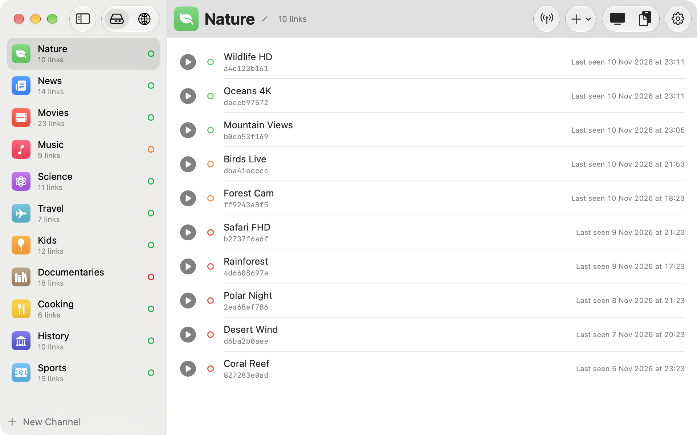

# AceLinkUI

AceLinkUI is a macOS app to organize and play Ace Streams: keep your links in channels, check which ones work, play them in any media player and share them with the TVs on your network.

Play an Ace Stream or Magnet in any media player by pasting the URL in the AceLinkUI menu, or open an acestream or magnet link in AceLinkUI.

<picture>
  <source media="(prefers-color-scheme: dark)" srcset="docs/screenshot-dark.png">
  
</picture>

## Credits

AceLinkUI builds on the work of two projects, both released under the MIT license:

- **[Ace Link](https://github.com/blaise-io/acelink)** by Blaise Kal: the original menu bar app that plays Ace Streams on macOS through the AceStream engine in Docker. The menu bar app, the engine pipeline and the engine image all come from it.
- **[e-ayguade/acelink](https://github.com/e-ayguade/acelink)** by Enric Ayguadé: the fork that introduced the Channels window, the initial concept of this UI, with channels, bulk import, availability checks and Share to TV. AceLinkUI started as a fork of it.

Thanks to both. Their copyright notices, and AceLinkUI's, are in [LICENSE](LICENSE).

## Channels

AceLinkUI opens a window where you can organize your streams:

- **Channels**: create a channel with a name and an icon (SF Symbol + color, an emoji, or your own image).
- **Links**: each channel holds several AceStream links (hash, `acestream://…` or `magnet:`). Adding a link pre-fills it from your clipboard, and warns if the link is already in this channel (not allowed) or in others.
- **Bulk add**: "Add in Bulk…" (⇧⌘L) takes many links at once, one per line, with an optional name on the same line (`HD Spanish acestream://…`). M3U playlists (`#EXTINF:-1,Name` + link) work too. Duplicates are skipped.
- **Remote list**: besides your own channels, the sidebar can show an M3U playlist from a URL, grouped into channels by `group-title`. A copy is kept, so the list is there even when the download fails.
- **Settings**: the toolbar's settings button sets the remote list's address, and exports or imports your channels to a file.
- **Check availability**: tests every link in a channel at the same time (or one link, from its context menu) by reading each one like a player would, and measures how fast the video arrives. Green = fast enough to watch (≥ 250 KB/s), orange = slow or stalled (likely to freeze), red = no peers, or peers but no video. The measured speed is shown under each link, and the channel's dot in the sidebar shows its best link. Working links move to the top, then slow ones, dead ones to the bottom, longest-dead last. A check takes about 15 seconds, or about 45 if a channel has dead links.
  - While something plays (on the Mac or a TV), a check tests 3 links at a time so it doesn't starve it, leaves out the links that are playing, and shows a clock on links waiting their turn.
  - The last result is remembered: after a restart each link shows it as a ring until it's checked again. "Last seen" shows when a link last worked, in a check or when it played.
- **Play**: click a link's ▶ button, or double-click the link, to start it. AceLinkUI starts the AceStream engine, then opens the stream in your media player (VLC by default).
- **Play alongside**: ⌥-click ▶ or ⌥-double-click a link (or right-click → Play Alongside) to watch it next to what's already playing, in a second player window. Playing a link normally replaces everything that's playing.
- **Now playing**: a playing link shows who watches it (This Mac, or a device on your network by the name it announces, e.g. "Samsung BU8000 43 TV") and its live download and upload rates and peers. The bar at the bottom of the window lists everything playing; with several streams, its ⌃ button opens a panel with each stream and Stop All. Hover a playing link's speaker (or right-click → Stop) to stop just that one.
- Right-click channels and links to edit, copy, or delete them. Drag to reorder.

- **Share to TV**: the TV button in the toolbar (or "Share to TV" in the menu bar menu) serves all your channels as a playlist at `http://<your-mac-ip>:8765/acelink.m3u`. Add it once in an IPTV app on your TV (tested with m3u-ip.tv on a Samsung TV). While it's on, the AceStream engine keeps running and the Mac doesn't sleep. The Mac and TVs can watch the same channel at once, and different channels too; AceLinkUI relays the video to the TV, so it knows what's being watched and stops downloading a channel about 30 seconds after nobody watches it. If a channel gets stuck or its session dies, AceLinkUI restarts it under the hood: the TV pauses briefly, repeats a few seconds and carries on. To show device names, macOS asks once for permission to find devices on your local network. Reserve your Mac's IP in your router so the address doesn't change. Links that were red in the last availability check are left out of the TV playlist (switch this off in the TV panel).

Channels are saved in `~/Library/Application Support/AceLinkUI/channels.json`. The menu bar icon still works as before, and closing the window keeps AceLinkUI running in the menu bar.

Coming from Ace Link? On its first launch AceLinkUI takes over Ace Link's channels and settings (`~/Library/Application Support/Ace Link` is moved to `AceLinkUI`).

## [Download for macOS](https://github.com/AirmakZ/AceLinkUI/releases/latest)

 - [All releases](https://github.com/AirmakZ/AceLinkUI/releases)

Requires macOS 13 or later. The AceStream engine runs:

- **On Apple silicon with macOS 26 or later**: in a lightweight Linux VM built into the app (Apple's Containerization framework, the engine runs through Rosetta). Docker isn't needed. The first start downloads the engine (a few hundred MB) into `~/Library/Application Support/AceLinkUI/Engine`. To use Docker anyway: `defaults write io.github.airmakz.acelinkui UseDocker -bool YES`.
- **Elsewhere**: in [Docker](https://www.docker.com/products/docker-desktop/), which must be installed.

### Media players

AceLinkUI allows selecting your own media player. AceLinkUI does not transcode streams, so pick a player that supports popular audio and video codecs. VLC, IINA and MPV are free and open source media players that are able to play nearly anything. QuickTime and web browsers will play most streams, but not all.

### Signing

AceLinkUI is an unsigned app because Apple does not allow p2p related applications. If your version of macOS does not allow opening unsigned applications, [follow these instructions to bypass this restriction](https://apple.stackexchange.com/a/240560).

### Building

Open `AceLinkUI.xcodeproj` in Xcode and run the `AceLinkUI` scheme, or build without Xcode:

```sh
scripts/build-app.sh            # builds build/AceLinkUI.app
scripts/build-app.sh --install  # also copies it to /Applications
```

Requires the Xcode Command Line Tools. The engine VM helper (`EngineHelper/`) needs Apple silicon and the macOS 26 SDK; without them the app is still built and uses Docker.

## Engine image

The AceStream engine is published as [`ghcr.io/airmakz/acelinkui`](https://github.com/AirmakZ/acelink/pkgs/container/acelinkui) (linux/amd64; there's no AceStream build for arm64). It's built from this repository's [Dockerfile](Dockerfile) and tagged with the AceStream version it contains, currently `3.2.11`; `latest` follows it.

### Ace Stream server only

If you just want to run the AceStream engine, you can do so without AceLinkUI:

```sh
docker run --platform=linux/amd64 --rm -p 6878:6878 ghcr.io/airmakz/acelinkui:3.2.11
# now open http://<network ip>:6878/ace/getstream?id=<acestream id>
# or http://<network ip>:6878/ace/getstream?infohash=<magnet uri> in a player
```

If you want to use a custom acestream.conf:
```
docker run --platform=linux/amd64 --rm -p 6878:6878 -v "$(pwd)/acestream.conf:/opt/acestream/acestream.conf" ghcr.io/airmakz/acelinkui:3.2.11
```

To build the image yourself: `make docker`.

### View AceLinkUI logs

1. Open Console.app
2. In the Console.app search field, type `Process: AceLinkUI`
3. Click on *Start* or *Start streaming*
4. Launch AceLinkUI and perform an action you want to debug
5. It should now start populating Console.app with debug information

When the engine runs in the VM, its own logs are in `~/Library/Application Support/AceLinkUI/Engine`: `helper.log`, `run/engine.log` and `run/boot.log`.
